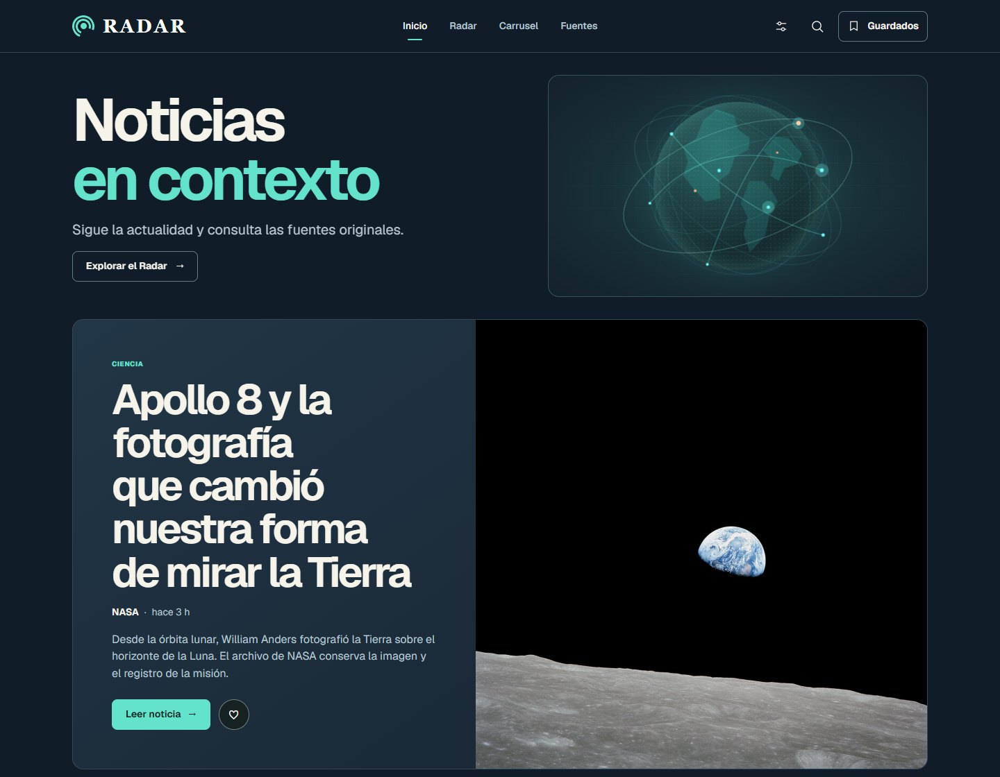
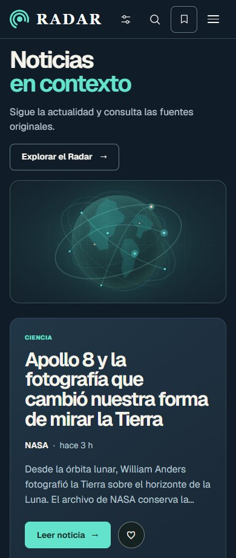
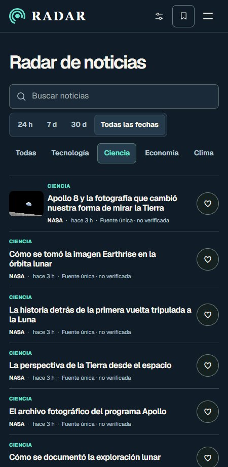
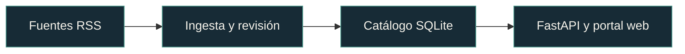

<div align="center">
  
  <a href="https://github.com/isyoimerr/Radar/stargazers"></a>
  <a href="https://github.com/isyoimerr/Radar/forks"></a>
  <a href="https://github.com/isyoimerr/Radar/issues"></a>
  <a href="LICENSE"></a>
  <br /><br />
  
  <p><strong>Lee la actualidad y encuentra la fuente original.</strong></p>
  <p><a href="#instalación-rápida">Instalación</a> · <a href="#despliegue-en-vercel">Vercel</a> · <a href="#arquitectura">Arquitectura</a></p>
</div>

## RADAR en pantalla

<div align="center">
  
  <table border="0" cellpadding="0" cellspacing="0" align="center">
    <tr>
      <td align="center"></td>
      <td align="center"></td>
    </tr>
  </table>
  <sub>Capturas con contenido ilustrativo. Fotografía <a href="https://eol.jsc.nasa.gov/SearchPhotos/photo.pl?frame=2383&amp;mission=AS08&amp;roll=14">Earthrise, NASA, AS08-14-2383</a>.</sub>
</div>

## Qué puedes hacer

<table>
  <tr>
    <td width="50%"><strong>🗞 Portada y Radar</strong><hr />Busca por tema o fecha. La lista muestra nueve noticias por página.</td>
    <td width="50%"><strong>🔖 Guardados sin cuenta</strong><hr />Guarda lecturas en tu navegador y ábrelas desde la cabecera.</td>
  </tr>
  <tr>
    <td width="50%"><strong>🌐 Español e inglés</strong><hr />Cambia el idioma de la interfaz y navega por noticias de esa edición.</td>
    <td width="50%"><strong>🖼 Carrusel editorial</strong><hr />Previsualiza diapositivas y descárgalas juntas en un ZIP.</td>
  </tr>
</table>

## Tecnologías

<div align="center">
  <a href="https://skillicons.dev"></a>
</div>

## Arquitectura



Las fuentes se conservan en cada noticia. El panel editorial permite revisar borradores. Cada lector conserva sus guardados en su navegador.

## Instalación rápida

Usa Python 3.13 y abre una terminal en la raíz del repositorio.

<details>
<summary><strong>Windows · PowerShell</strong></summary>

```powershell
python -m venv .venv
.\.venv\Scripts\python.exe -m pip install -r requirements.txt
.\.venv\Scripts\python.exe run.py
```

</details>

<details>
<summary><strong>Linux o macOS</strong></summary>

```bash
python3 -m venv .venv
.venv/bin/python -m pip install -r requirements.txt
.venv/bin/python run.py
```

</details>

Abre [RADAR en localhost](http://localhost:8000/) o consulta [la API](http://localhost:8000/api/docs). La primera ronda RSS se ejecuta en segundo plano cuando la base está vacía.

<details>
<summary><strong>Configuración editorial y pruebas</strong></summary>

- Copia [`.env.example`](.env.example) a `.env` para configurar el administrador o habilitar Gemini.
- Abre **Acceso editorial** en el pie de página. Si el servidor genera una clave inicial, consulta `data/admin_credentials.txt`.
- Instala `pytest` y `httpx` en tu entorno virtual. Define `RADAR_DATA_DIR` con un directorio temporal antes de ejecutar `python -m pytest -q`.

</details>

## Despliegue en Vercel

1. Abre [Importar en Vercel](https://vercel.com/new) y selecciona **isyoimerr/Radar** desde GitHub.
2. Usa la raíz del repositorio y el framework **FastAPI**. El punto de entrada está en [`pyproject.toml`](pyproject.toml).
3. Configura `PUBLIC_URL` con tu dominio HTTPS. Para usar el panel editorial, define valores privados para `ADMIN_PASSWORD` y `RADAR_SESSION_KEY`. Consulta [`.env.example`](.env.example) para ver las demás variables.
4. Despliega y abre `/api/health` en el dominio asignado.

En Vercel, SQLite usa [el espacio temporal `/tmp`](https://vercel.com/docs/functions/runtimes#file-system-support). Si necesitas conservar el catálogo, las cuentas y la revisión editorial entre instancias, usa un [contenedor con volumen persistente](Dockerfile) o adapta el almacenamiento a una base gestionada.

## Proyecto

[Documentación](docs/) · [Pruebas](tests/) · [Código](radar/) · [Licencia MIT](LICENSE)

<div align="center">
  <sub>RADAR · <a href="https://github.com/isyoimerr/Radar">isyoimerr/Radar</a></sub>
  
</div>
